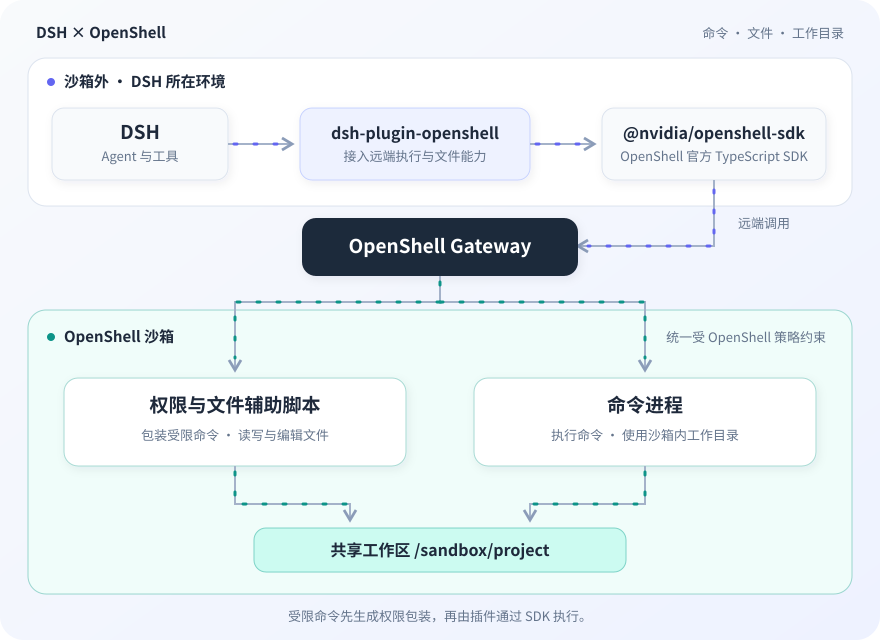

# dsh-plugin-openshell

让运行在沙箱外的 DSH，通过 OpenShell 官方 SDK 使用指定沙箱的命令执行、文件和工作目录能力，并施加逐调用文件权限。



插件通过官方 SDK 在同一沙箱内执行命令、读写文件；受限命令先由辅助脚本生成权限包装。命令与文件操作共享沙箱内的工作区。

固定基线：**DSH 0.2.1-rc.4 · Cordis 4.0.5 · OpenShell 0.1.6**。

## 当前能用到什么程度

| 状态 | 能力                    | 说明                                                                     |
| ---- | ----------------------- | ------------------------------------------------------------------------ |
| ✅   | 文件操作                | 读写、编辑与搜索已通过真实远端验收                                       |
| ✅   | 工作目录                | 支持目录切换，命令与文件操作共享工作区                                   |
| ✅   | 命令执行                | 普通执行及诊断模式下的逐调用权限限制已验证                               |
| ✅   | 部署                    | HTTP／mTLS、重复部署复用与策略更新已验证                                 |
| ✅   | 取消与超时              | 可停止受测同组父子进程，资源释放行为已验证                               |
| ❌   | 完整命令隔离            | 测试环境为 `partial`，默认严格模式拒绝受限命令；放宽检查不会获得完整隔离 |
| ❌   | 整个进程树停止保证      | 主动脱离进程组的子进程仍可能存活                                         |
| ❌   | 完整 DSH Agent 流程验收 | 尚未完成                                                                 |

## 快速部署

在**已有 OpenShell 0.1.6 Gateway 的 Linux x64 主机**上，准备 Node.js 22.19+ 的 22.x 或 Node.js 24+、Docker Compose v2：

```sh
cp -n .env.example .env
chmod 600 .env
# 按实际环境修改 .env
node deploy/deploy.mjs
```

默认连接 `http://127.0.0.1:18080`，无需证书。脚本自动下载并校验固定版本 CLI、构建镜像、创建或复用沙箱，等待策略生效与 READY 后报告成功。已有 Gateway 的启动与授权由部署方准备。

HTTP 适用于回环或受控内部网络，无传输加密及客户端身份认证；无认证 Gateway 需显式允许匿名用户，配置见[部署指南](docs/30-guides/DEPLOYMENT.md)。需要加密和身份认证时使用可选 HTTPS/mTLS。主机无法访问 GitHub 时，可通过 `DSH_OPENSHELL_CLI_PATH` 指定预装 CLI。

## 按需阅读

| 你要做什么                                   | 文档                                         |
| -------------------------------------------- | -------------------------------------------- |
| 配置 HTTP／HTTPS、离线 CLI、镜像与重复部署   | [部署指南](docs/30-guides/DEPLOYMENT.md)     |
| 安装接入包、运行示例、配置文件／工作区／搜索 | [DSH 接入指南](docs/30-guides/USAGE.md)      |
| 运行本机或远端测试、查找代码入口             | [验证与开发](docs/30-guides/VALIDATION.md)   |
| 核对产品范围与验收条件                       | [需求](docs/10-requirements/REQUIREMENTS.md) |
| 查看架构、真实验收证据与未覆盖项             | [设计](docs/20-design/DESIGN.md)             |
