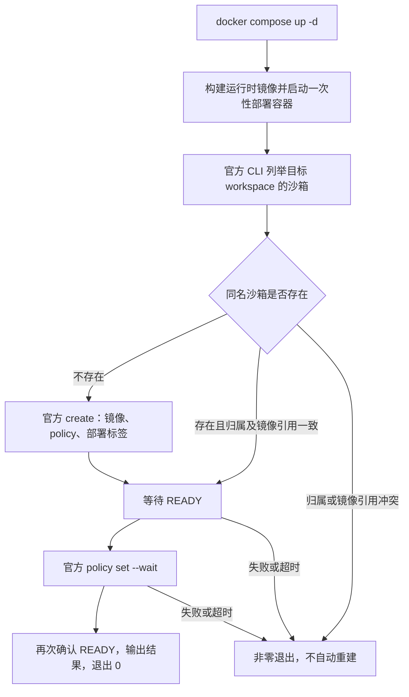
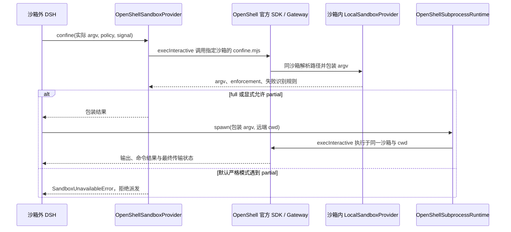
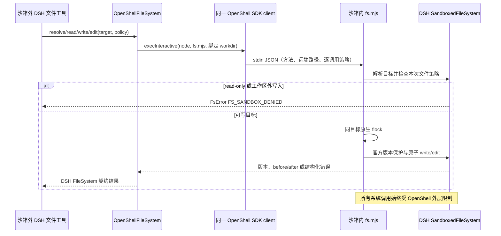

# DSH Sandbox OpenShell 设计

## 包与 Provider

`dsh-sandbox-openshell` 面向在 OpenShell 沙箱外运行的 DSH。仅通过注入的官方 `SandboxClient.execInteractive` 使用 gRPC 执行入口，不实现 SSH 连接或控制面。

| 包／类                                                    | 位置                               | 职责                                                                                               |
| --------------------------------------------------------- | ---------------------------------- | -------------------------------------------------------------------------------------------------- |
| `dsh-sandbox-openshell` / `OpenShellSandboxProvider`      | src/sandbox/provider.ts            | 与 dsh-sandbox-ssh 同形的 confine 接口，将权限包装请求送入指定沙箱；默认拒绝 partial               |
| `dsh-sandbox-openshell` / `OpenShellSubprocessRuntime`    | src/subprocess/provider.ts         | 实现 DSH SubprocessRuntime；通过 SDK 交互式执行与客户端 deadline，输出收集复用官方 OutputCollector |
| `dsh-sandbox-openshell` / `OpenShellFileSystem`           | src/fs/provider.ts                 | DSH FileSystem 契约、远端目标身份、SDK stdin 文件请求及文本流                                      |
| `dsh-sandbox-openshell` / `OpenShellWorkspace`            | src/workspace/binding.ts           | 固定沙箱与远端 workspaceRoot，不持有 Session／卷控制状态                                           |
| `dsh-sandbox-openshell` / `OpenShellWorkingDirectory`     | src/workspace/working-directory.ts | 复用 DSH WorkingDirectoryService，验证工作目录属于远端绑定根                                       |
| `@deepseek-ai/dsh-fs-sandbox` / `SandboxedFileSystem`     | src/runtime/fs.mjs 调用            | 远端路径解析、读写、版本保护、原子编辑及逐调用文件策略                                             |
| `dsh-sandbox-openshell` / `OpenShellConnection`           | src/connection.ts                  | 绑定同一官方 SDK client 与沙箱、有限输出的 helper 调用与回包检查                                   |
| `@deepseek-ai/dsh-sandbox-local` / `LocalSandboxProvider` | src/runtime/confine.mjs 调用       | 在沙箱内选择实际权限后端并包装 argv，使用上游文件权限实现                                          |

基线为 DSH **0.2.1-rc.4**、Cordis **4.0.5**、OpenShell **0.1.6**、远端 Node.js **24**。本包不依赖 dsh-ssh、dsh-fs-ssh 或 dsh-sandbox-ssh。必要的 Subprocess Provider 解决执行环境一致性：本地 Subprocess Provider 无法执行沙箱内的 launcher 路径，也无法正确解释沙箱内 cwd。

## 沙箱运行时镜像

部署配置归入 deploy/runtime、deploy/openshell、deploy/diagnostics。正式构建通过 deploy/compose.yaml 的 runtime 服务使用仓库根 context 和 deploy/runtime/Dockerfile；相邻 Dockerfile.dockerignore 按 Docker 的 Dockerfile 专属过滤规则限制 context。诊断层只用于验收，仍从同一正式镜像派生；其 Dockerfile 与过滤文件也由 deploy/ 维护，测试代码不维护第二份构建定义。

Docker Compose v2 的 up -d 是完整部署入口。runtime 是一次性初始化服务：使用正式运行时镜像中的 Node，挂载 deploy.mjs、policy、官方 Linux CLI 0.1.6 和只读 mTLS 目录；连接既有 Gateway，列举当前 workspace 的沙箱，校验部署标签和镜像引用，缺失时 create，等待 READY 后调用 policy set --wait，再确认 READY，退出 0。命令超时和失败不重放创建操作，后续重新启动先对账同名资源。

部署标签只是幂等归属检查，不是身份或授权系统。该流程不管理 Gateway、不挂载管理 socket、不驻留轮询，也不实现 Run、generation 或持久化控制面。同名非本部署资源或镜像引用变化失败；Compose down 不删除远端沙箱。初始化以 root 读取只读客户端文件，临时证书副本仅位于 tmpfs；OpenShell 沙箱中的 worker 仍为 node 用户，不持有部署凭据。HTTP 与 mTLS Compose 部署均已真实验收；交互式 OIDC/edge 登录尚未验收。

COMPOSE_FILE 在根 .env 中指向 deploy/compose.yaml，使仓库根的 docker compose up -d 直接可用。私有机器路径和认证材料仅在 .env 及忽略的目录中配置；NODE_IMAGE、镜像引用、构建网络和目标沙箱可显式配置。正式镜像不包含部署脚本、CLI 或客户端凭据。

deploy/runtime/Dockerfile 是可复用镜像的唯一构建定义。默认基础为 Node.js 24.19.0 bookworm-slim 的固定多架构 manifest digest；依赖阶段以 npm ci --omit=dev --ignore-scripts 从 src/runtime 锁文件安装，最终阶段只复制运行依赖、confine.mjs 和 fs.mjs；依赖包括 Linux x64 ripgrep 1.18.0。无需宿主 Node 或预装的私有基础镜像。平台验收范围为 Linux x64。基础镜像的镜像源／缓存引用只通过私有 DSH_OPENSHELL_NODE_IMAGE 测试配置替换，本次缓存内容已按官方 index、平台 manifest、config 和 layer 摘要核对；不改全局镜像源。

最终镜像使用 node 用户（1000:1000），/sandbox/project 可写，/opt/dsh-runtime 全部 root 所有且去掉写位。默认 CMD 为 sleep infinity，不启动常驻 helper 服务。SDK 和 DSH Provider 在镜像外；每次权限包装通过 SDK 调用镜像内脚本。deploy/runtime/Dockerfile.dockerignore 使用允许列表，凭据与调试产物不进入构建上下文。

deploy/openshell/policy.yaml 与镜像配套：允许读取 Node、系统库及 helper，允许写入工作区／临时目录，默认无网络出口。它是最小部署样例；具体用户授权与更广网络能力由部署方管理。

真实验收通过同一 deploy/compose.yaml 构建 deploy/runtime/Dockerfile，先检查 Compose 展开后的镜像、平台和未注入 SSH 测试凭据，再用真实 up -d 完成正式沙箱创建和策略加载，连续启动两次确认沙箱 ID 不变，创建一个没有任何 fixture 文件的正式镜像沙箱，检查非 root、RC 版本、helper／锁文件不可写，并由沙箱外正式 DSH Provider 完成 SDK 调用及 wrapped argv 执行。ABI 和 bwrap 工具只加入另一个诊断镜像，不作为正式镜像依赖。两层镜像和临时资源分别清理，原 Gateway 保持不变。

### 内置 .mjs helper 的决策与职责（R1、R3–R5、R7、R10）

保留沙箱内的 `confine.mjs` 和 `fs.mjs`，以维持逐调用权限和 DSH 文件接口契约。OpenShell 负责官方执行传输、身份与沙箱外层限制；helper 在同一沙箱内复用锁定版本的 DSH 实现。路径解析、权限后端探测和文件系统操作必须针对远端执行环境，不能移到宿主执行后将结果当作远端事实。

锁定的 OpenShell v0.1.6 官方 SDK `ExecOptions` / `ExecInteractiveOptions` 不提供逐命令文件权限策略；`setPolicy` 的沙箱级更新只允许改变网络策略，文件系统等静态字段须与创建时一致，不能据此在同一沙箱中逐调用切换 read-only / workspace-write。核对依据为[固定 revision 的官方 SDK](https://github.com/NVIDIA/OpenShell/blob/ac7f615cd12d5cc49cb16eb1f5f10ffeb1e90f47/sdk/typescript/src/client.ts)。原生执行能力也没有直接提供 DSH 文件版本、字面编辑和 FsError 契约，因此仅改用原生命令不能等价替代两个 helper。

| 脚本                      | 输入与输出                                                                                                                   | 沙箱内职责                                                                                                                                                     | 删除后的能力损失                                                                                                          |
| ------------------------- | ---------------------------------------------------------------------------------------------------------------------------- | -------------------------------------------------------------------------------------------------------------------------------------------------------------- | ------------------------------------------------------------------------------------------------------------------------- |
| `src/runtime/confine.mjs` | argv 参数中的 base64 JSON（实际 argv、policy）；输出带 RC 版本的包装 argv、enforcement、denialSignatures、runnerFailureRules | 校验请求与依赖版本，创建短生命周期 Cordis Context，调用官方 LocalSandboxProvider，根据远端环境选择后端并生成命令包装；本脚本不执行目标命令                     | 失去同一沙箱内的逐调用命令权限收窄及上游 enforcement／拒绝识别契约；命令仍可通过 SDK 执行，但只受外层策略和 Unix 权限约束 |
| `src/runtime/fs.mjs`      | stdin JSON（方法、远端路径、绑定工作区、策略及方法参数）；输出版本化 JSON 结果／FsError，文本流使用逐行 JSON                 | 调用官方 SandboxedFileSystem，完成路径解析、stat/lstat、文本／字节／目录读取、带策略的原子 write/edit 与版本保护；补充传输上限和合作 helper 之间的同目标 flock | 失去现有 DSH 结构化文件接口；基础读写可另用命令实现，但版本保护、字面编辑、错误映射、流式协议及并发协调均须重新适配       |

两个脚本对应不同的权限入口，不能互相替代。权限分工如下：

| 层级                                 | 允许范围与约束                                                                     | 不能据此承诺的能力                                                                   |
| ------------------------------------ | ---------------------------------------------------------------------------------- | ------------------------------------------------------------------------------------ |
| OpenShell 外层                       | 定义沙箱最大文件／网络权限；helper 和实际命令都受其限制                            | 外层允许工作区写入，不代表某次 DSH read-only 调用已被收窄                            |
| `confine.mjs` / LocalSandboxProvider | 对经过 confine 的命令按次收窄；默认严格模式只接受 full，partial 拒绝派发           | 普通 spawn 不自动获得内层限制；不能把外层限制与内层 partial 叠加称为 full            |
| `fs.mjs` / SandboxedFileSystem       | 对文件接口 write/edit 检查本次策略，保留路径、版本和编辑语义；读取范围沿用上游规则 | 文件路径策略不是任意代码执行的内核隔离；flock 不阻止不合作的 shell／其他进程修改文件 |

例如，外层允许工作区写入时，read-only 命令仍须经 confine 收窄，read-only 文件写入仍须由文件接口拒绝。workspace-write 也只能在上游允许的工作区／临时目录内写入，并继续服从外层限制。工作区绑定不是文件读取隔离承诺。当前环境的 partial、符号链接竞态和取消后的不确定结果沿用下文限制，保留 helper 不等于这些缺口已经解决。

`.mjs` 是 Node.js ESM 的直接执行形式，不需要沙箱内 TypeScript 编译或额外服务协议。真正需要保留的是沙箱侧功能与锁定依赖，而非扩展名；改成内联脚本或其他打包形式仍须承担同样的语义。当前选择薄入口复用上游，避免另写权限后端或文件编辑实现。

部署时由 deploy/runtime/Dockerfile 一次性将两个脚本和 `src/runtime` 锁定依赖安装到只读 `/opt/dsh-runtime`；使用该镜像无需再手工上传。每次通过官方 SDK 按需启动 Node，结束后释放 Context 和锁，不启动常驻 helper。`scripts/*.mjs` 与 `tests/**/*.mjs` 是构建／验证入口，不进入正式镜像。成本是镜像内 Node／依赖和每次调用的进程启动开销，实际延迟与容量尚未测量。

只有产品范围改为“固定权限沙箱中的普通命令执行”，并明确放弃逐调用命令权限和 DSH FileSystem 契约时，才适合同时移除两者；这会改变现有需求和验收条件。当前细致权限刻画的目标下，保留两个 helper。

## 数据流

配置必须提供已绑定 Gateway 的官方 SDK client、固定沙箱名和 helper；不再接收 cli 或冗余的 gatewayEndpoint，缺少 client 立即拒绝；`apply` 在同一 Context 安装三个 Provider 和固定工作区服务。Sandbox Provider 检查实际 Subprocess Provider 类型并复用其连接配置，避免只包装远端命令却在本地执行。权限 helper 和实际命令通过同一个 SDK client 调用。执行参数以 argv 数组传入；不将模型输入拼进 shell。helper 请求使用 base64 JSON，限制 64 KiB，回包限制 1 MiB，校验 RC 版本及结构。

沙箱镜像需预装 `confine.mjs`、`fs.mjs`、Node 和锁定的 LocalSandboxProvider 依赖，且 helper 与依赖不在可写工作区。部署身份与凭据由 OpenShell 官方配置管理；本包不分发凭据，Provider 不自动创建沙箱；一次性部署入口调用官方创建能力，不接管 Gateway 生命周期。

## 权限与执行边界

OpenShell 外层权限始终生效。内层 LocalSandboxProvider 处理 read-only 和 workspace-write。外层允许写入不代表每次调用允许写入；内层放行也不能突破外层限制。默认 `requireFullEnforcement=true`，partial 返回 `SandboxUnavailableError`。明确设置 false 才允许诊断或接受上游 best-effort 语义的消费者执行 partial，不改变 enforcement 标记。

Subprocess Provider 只提供普通进程；PTY、控制 fd、远端环境覆盖显式拒绝。远端 cwd 通过 SDK 的 workdir 传递，不在本地启动命令或 CLI 子进程。显式 lookup 在远端执行。FileSystem 使用同一 SDK 连接与沙箱；不得以宿主 LocalFileSystem 替代。普通 spawn 不自动施加内层权限，受限的任意代码执行仍须先 confine。

### 远端文件与 workspace 绑定（R7–R10）

可信配置 `workspaceRoot` 默认 `/sandbox/project`，`defaultMode` 默认 read-only。`fileSystemHelper` 默认位于 confine.mjs 同目录。fs 的相对路径以这个远端根解析；process 的 cwd 明确由调用方传入，示例与工具使用同一根／其子目录；sandbox 拒绝将 policy.workspaceRoot 扩大到绑定根之外。默认根必须由部署方准备为目录，fs helper 实际检查存在性。读文件仍沿用 DSH 的可读范围语义，不把 workspace 误作读隔离边界。

`OpenShellWorkspace` 只保存固定 root 和 sandbox。正常 DSH sessionProjections/systemPrompt 就绪时安装 `OpenShellWorkingDirectory`，继承官方 WorkingDirectoryService 的目录验证、Session 变更日志、串行化与上下文提示；ensure/set 额外通过远端 fs 的 canonical target 检查绑定范围。空路径交回上游拒绝；失败的切换不得追加 Session 事件。Session header.cwd 应填远端路径；不加载另一个本地目录 Provider。没有新增 workspace registry、持久存储或卷生命周期服务。

文件 helper 按 RC 版 `SandboxedFileSystem` / `LocalFileSystem` 执行 stat/lstat、文本及字节读取、目录列表、原子写入和字面编辑，不自行实现版本 token 或编辑规则；编辑前在锁内估算结果字节数，超限先拒绝，实际匹配、错误规则和发布仍交给 DSH。默认策略在每个短生命周期 helper 中以固定配置提供，实际 write/edit 始终传显式 DSH SandboxExecutionPolicy；不创建 Session 策略存储。read-only 在创建锁文件前即拒绝；workspace-write 使用上游 writableRoots（工作区和临时目录），danger-full-access 仍不能突破 OpenShell 外层或 Unix 权限。

此处编辑结果上限按 LF 规范化文本计；物理 CRLF 写回由 DSH 保留。

原子的 read→版本检查→编辑→发布在沙箱内完成。上游实例锁仅覆盖单个 helper，所以同目标另用 `@deepseek-ai/node-addon-system/flock` 串行化不同 SDK 调用；锁文件位于 UID 私有的 `/tmp/dsh-openshell-fs-UID`，目标 canonical key 经 SHA-256 命名，关闭 fd 释放锁。它只协调合作的文件 helper，不是跨控制器协议，也不阻止任意进程直接改文件。原生锁不可用时失败，不退化为无锁写入。

文件 target 由 Provider 加命名空间并记录远端 canonical path，拒绝其他实例的 target；同实例内别名保持同一 key。fileUrl 按 POSIX 文件路径编码，processPath 提供同沙箱进程可打开的路径，processPathFromHostPath 保持无映射，watch 显式沿用不支持行为。

普通文件请求通过 SDK stdin 传 JSON，每条输入消息至多 64 KiB，避免 argv 长度及官方 1 MiB gRPC 消息限制；校验 helper RC 版本，保留官方 FsError code，并把原始 EACCES/EPERM/EROFS 归为 FS_PERMISSION_DENIED。序列化请求限 1 MiB + 64 KiB，普通回包限 16 MiB；readText/readBytes、写入文本、编辑结果和每次字节窗口限 1 MiB，超限拒绝而不截断。streamText 复用沙箱内 DSH 的增量 UTF-8 解码与二进制检查，以逐行 JSON 分块，经 SDK 流返回，不整文件缓冲；消费结束／取消／Context dispose 关闭本次 RPC，必须收到结束记录和成功的最终状态才算读完。普通 helper 使用 15 秒客户端预算，文本流使用 executionTimeoutSeconds；均关闭服务端 timeout。

文件策略属于上游受信代码中的路径约束，**不声明内核 full**。它保留上游 canonicalize/contain 检查与系统调用之间的祖先符号链接竞态限制；与不合作的任意文件修改也没有跨进程事务隔离。原子写入在取消或断线前可能已经发布，不能根据 RPC 失败断言没有变更；不自动重放，应读回版本和内容对账。

### DSH 搜索工具

RC `@deepseek-ai/dsh-tool-fs-search` 的 glob/grep 不走 FileSystem 方法，而是固定 argv 的 ctx.subprocess ripgrep 工作流。它的 resolveRgPath 返回宿主打包二进制路径，因此提供受信 `searchExecutable: { host, remote }` 配置：仅精确替换匹配的 argv[0]，其余 argv、cwd、退出码与收集语义不变。镜像包含 `/opt/dsh-runtime/node_modules/@vscode/ripgrep-linux-x64/bin/rg`，不把宿主二进制传入沙箱；工具仍复用官方参数构造、--no-config 防配置注入、解析、空结果和错误规则。

正常带 Agent 的工具调用通过 OpenShellWorkingDirectory.ensure 取得远端工作目录。无 Agent 时上游回退到宿主 process.cwd，本包不自动转换该路径；上层应传 Agent。搜索是受信的固定只读工作流，保持上游不经过 sandbox.confine 的行为，OpenShell 外层限制始终存在。

### 官方交互式执行适配

调用方将官方 SandboxClient 作为 `interactiveClient` 注入。本包不复制 SDK 的传输、认证或刷新逻辑，也不依赖 SDK 的私有字段。结构接口在 src/subprocess/interactive.ts，实际兼容验证使用官方 v0.1.6 源码 `ac7f615cd12d5cc49cb16eb1f5f10ffeb1e90f47` 构建的 SDK。

SDK 路径始终使用 `tty:false`、`noLoginShell:true`、`timeoutSecs:0`，将 executionTimeoutSeconds 转为客户端 AbortSignal deadline。固定 stdin.data 和管道 stdin 的每次写入均按至多 64 KiB 分帧，保留原始字节顺序，避免单条输入超过官方 1 MiB gRPC 消息上限。stdin EOF 使用 closeInput，取消使用 signal/cancel，二者不能混为一谈。输出泵与 session.done 并发，只有最终 gRPC 状态成功才返回命令退出码；末尾退出事件后 RPC 失败仍拒绝成功。管道尊重背压，收集及 spill 复用 DSH OutputCollector。terminate、调用方取消和 Context dispose 均取消本次 SDK 流，不停止整个沙箱。

客户端 deadline 会拒绝 done，不伪造远端 exit=124。waitForExit 在传输结束后仍报告远端范围退出未确认；受测父进程和同组子进程消失，不等于任意逃逸后代已退出。生产代码没有 CLI 兼容分支，Subprocess Provider 直接继承 DSH SubprocessRuntime，仅复用 dsh-subprocess-local/output 的收集工具，不加载本地进程 Provider。

### partial 根因与可用的官方选项

实测原生 syscall 查询得到 Landlock ABI **4**；锁定的 `@deepseek-ai/node-addon-system@0.1.2` launcher 源码以 MAX_ABI=5 判定 full，ABI 5 新增设备 ioctl 文件权限位。官方 launcher 的功能 probe 实际返回 `landlock: partially enforced (older ABI)`，并非版本解析或 stderr 分类错误。

安装同宿主的 bwrap/unshare 诊断二进制后仍无法创建 user namespace：bwrap 返回 1，unshare 返回 EPERM；进程处于 NoNewPrivs=1、Seccomp=2、无有效 capabilities 的边界内。v0.1.6 官方 seccomp 源码明确阻止 CLONE_NEWUSER 及 mount/setns 等操作，因此不能把增加 bwrap 二进制当作 full 修复，也不应为内层工具放松外层权限。

可行路径是由部署方提供支持上游完整基线的内核／后端，并在该环境重新跑 full 正向验收。调整 OpenShell 的 Landlock compatibility 只能改变外层处理方式，不能补齐内核缺失的权限位；不改小 MAX_ABI，不把外层策略与内层 partial 合称 full。当前环境不升级内核、不修改共享宿主配置，严格模式继续拒绝。

### 官方源码核对

- [固定版本 SDK 的 execInteractive / cancel](https://github.com/NVIDIA/OpenShell/blob/ac7f615cd12d5cc49cb16eb1f5f10ffeb1e90f47/sdk/typescript/src/client.ts)：closeInput 是半关闭，cancel 是 RPC 取消。
- [Gateway 执行与超时路径](https://github.com/NVIDIA/OpenShell/blob/ac7f615cd12d5cc49cb16eb1f5f10ffeb1e90f47/crates/openshell-server/src/grpc/sandbox.rs)：交互式路径观察 tx.closed 并显式关闭通道。服务端 tokio::time::timeout 丢弃 future 后产生 124，跳过 future 末尾关闭代码。
- [官方 channel_close](https://github.com/NVIDIA/OpenShell/blob/ac7f615cd12d5cc49cb16eb1f5f10ffeb1e90f47/crates/openshell-supervisor-process/src/ssh.rs) 与 [LocalExecProcess::deliver](https://github.com/NVIDIA/OpenShell/blob/ac7f615cd12d5cc49cb16eb1f5f10ffeb1e90f47/crates/openshell-sandbox/src/boundary_exec.rs)：关闭通道会 terminate 本次 exec，Linux 本地实现使用 killpg，因此不能覆盖 setsid 脱离进程组的后代。
- [固定版本 seccomp](https://github.com/NVIDIA/OpenShell/blob/ac7f615cd12d5cc49cb16eb1f5f10ffeb1e90f47/crates/openshell-sandbox/src/sandbox/linux/seccomp.rs)：bwrap 所需的 user namespace / mount 操作与外层边界冲突。

以上为固定源码检查，下面另列真实环境的独立验证，不将 issue 中其他人的报告当作本项目验收。

## RC 验证结果

真实测试使用仓库内 Node .mjs 入口、独立临时 Gateway、一个纯正式镜像沙箱与两个诊断沙箱；DSH 测试程序在沙箱外运行。服务器信息保存在忽略的 `.env`。

| 范围                                                                                                             | 结果                                                                                                                                                                                                |
| ---------------------------------------------------------------------------------------------------------------- | --------------------------------------------------------------------------------------------------------------------------------------------------------------------------------------------------- |
| read-only 文件与 shell 重定向                                                                                    | 工作区、工作区外、外层受限目录均拒绝                                                                                                                                                                |
| workspace-write 文件与 shell 重定向                                                                              | 工作区成功；工作区外及外层受限目录拒绝                                                                                                                                                              |
| 未加内层包装的对照调用                                                                                           | 工作区和普通外部路径可写；外层受限目录仍拒绝                                                                                                                                                        |
| enforcement                                                                                                      | 当前环境为 partial；默认严格 Provider 拒绝，显式诊断 Provider 才实际执行权限矩阵                                                                                                                    |
| Compose 部署                                                                                                     | 真实 up -d 创建指定正式沙箱并等待 policy 生效；重复启动复用同一沙箱 ID，初始化容器退出 0                                                                                                            |
| 正式镜像                                                                                                         | 固定基础镜像与 RC 锁文件构建；外部 DSH SDK 调用 helper、包装与执行命令，UID 1000、helper／锁文件不可写，无诊断文件                                                                                  |
| 普通执行                                                                                                         | 远端 cwd、stdin、stdout、stderr、非零退出码、可执行文件查找、原样参数以及两个配置目标的隔离通过                                                                                                     |
| 文件基础接口                                                                                                     | Compose 部署                                                                                                                                                                                        | 真实 up -d 创建指定正式沙箱并等待 policy 生效；重复启动复用同一沙箱 ID，初始化容器退出 0 |
| 正式镜像实测 resolve、stat/lstat、文本／字节／窗口／目录列表、write/edit；同实例别名身份一致，跨实例 target 拒绝 |
| 文件逐调用策略                                                                                                   | 默认 read-only 拒绝；显式 workspace-write 可写；read-only 编辑拒绝、区外符号链接拒绝、临时目录遵循同一逐调用规则、danger-full-access 仍受外层拒绝                                                   |
| 文件原子性与版本                                                                                                 | createIfAbsent 重复拒绝；过期 write 拒绝；两个并发 helper 使用同一旧版本，仅一个写入成功；编辑歧义／无匹配错误保留；超限编辑拒绝且原内容不变                                                        |
| 文件流与上限                                                                                                     | 二进制拒绝；小 byte cap 与超 1 MiB readText 拒绝；1.2 MiB UTF-8 文件 streamText 完整读回；超过单条 gRPC 上限的请求按 64 KiB 分块通过；预取消拒绝                                                    |
| 工作目录切换                                                                                                     | RC 服务完成子目录与父目录往返；空路径、区外路径、区外符号链接和不存在目录拒绝，失败不追加 Session 事件，成功通知正常                                                                                |
| 执行世界与搜索                                                                                                   | process 可读 fs 写入、fs 可读 process 写入；自定义工作区完成 fs→confine/spawn→fs 闭环，父级策略根拒绝；官方 WorkingDirectoryService 派生服务及 RC runRipgrep 的 grep/glob/空结果通过，区外 cwd 拒绝 |
| SDK 适配器 cancel／deadline／dispose                                                                             | 正式 Provider 的 cancel、deadline、dispose 均停止受测同组父子进程；仍报告范围退出未确认                                                                                                             |
| setsid 后代                                                                                                      | 官方 SDK 取消后父进程停止，但脱离进程组的子进程存活并写出延迟标记                                                                                                                                   |
| 清理                                                                                                             | 临时资源清理通过；原 Gateway 配置和沙箱清单不变                                                                                                                                                     |

依赖版本与兼容覆盖配置由根 pnpm 锁文件、pnpm-workspace.yaml 及沙箱／外部客户端的 npm 锁文件固定，变更后按 REQUIREMENTS.md 的验收入口复测。

2026-11-06，改用固定 revision 的源码归档及 SHA-256 校验构建官方 SDK 后，重新运行 `pnpm test:remote`，退出码为 0。正式镜像、命令权限与执行、文件／工作区／搜索、取消／deadline／dispose、mTLS Compose 创建／复用／策略更新和认证拒绝场景均通过；临时资源清理通过，原 Gateway 配置与沙箱清单不变。环境仍为 partial，setsid 后代存活的已知边界保持不变；不构成 full 隔离或完整 Agent 循环验收。

本次文件接入验收日期为 2026-11-05；文件路径检查通过不改变上表命令 enforcement=partial 的结论。未使用完整模型推理循环替代工具契约验证。

本机文件契约覆盖 SDK stdin 协议、跨帧 UTF-8、目标隔离、默认根／模式、类型化错误、版本不符、上限及预取消／dispose；真实 fs.test.mjs 使用正式镜像上的实际文件方法和 RC 搜索执行流程。搜索测试的 Agent-facing Session/Projection 使用最小夹具，目录服务与 runRipgrep 为真实 RC 实现，不等于完整 DSH Agent 集成。

2026-11-06，针对 PR #3 的大块 stdin review，新增超过 1 MiB 的固定与管道输入回归：修复前本机重现单帧超限，按 64 KiB 分帧后本机原始字节一致；真实远端两种输入的 SHA-256 与发送端一致。`pnpm check`、`pnpm test`、`pnpm build` 和完整 `pnpm test:remote` 通过，临时资源清理通过且原 Gateway 配置及沙箱清单不变。

本机契约覆盖参数与 cwd 传递、partial 默认拒绝、回包版本不符、预取消、配置校验和取消后的不确定状态；SDK 适配另测绑定目标、stdin/输出、关闭服务端 timeout、最终 RPC 状态失败和预取消不派发。本机使用 SDK 结构夹具检查契约，不模拟或启动 CLI；这些检查不替代远端验收。

## mTLS Compose 验收（R11）

2026-11-05，OpenShell 0.1.6、DSH 0.2.1-rc.4、Linux x64 / Node.js 24 的隔离环境验证通过。测试主机配置只读取忽略的 .env；这里不记录服务器地址、用户名、机器路径或证书内容。

| 项目       | 实测结果                                                                                                                                             |
| ---------- | ---------------------------------------------------------------------------------------------------------------------------------------------------- |
| 身份配置   | 官方 generate-certs 生成临时 CA 与 openshell-user 客户端证书，开启 mTLS 用户认证、关闭匿名用户访问；未依赖 operator 权限                             |
| 服务端校验 | 无客户端证书的管理 API 返回 UNAUTHENTICATED（gRPC 16）；同一受信服务端 CA 配合错误签发 CA 的客户端证书被拒绝                                         |
| 首次 up -d | 根 .env 指定 COMPOSE_FILE，直接执行 docker compose up -d；返回 created=true、READY，初始化容器退出 0                                                 |
| 重复启动   | 再次 up -d 返回 created=false，沙箱 ID 保持不变                                                                                                      |
| 策略更新   | 修改临时 policy 的 network_policies，第三次 up -d 后沙箱 ID 不变；current_policy_version 从 1 升至 2，活动策略可读回新增规则，policy set --wait 成功 |
| 数据边界   | 更新仅验证策略加载与有效版本，不宣称验证外部目标连通性；测试规则使用保留的 .invalid 域名，没有向外部发送请求                                         |
| 清理       | 临时初始化容器、沙箱、Gateway、证书与镜像清理完成，原 Gateway 配置摘要和沙箱清单不变                                                                 |

Docker driver 在 Gateway TLS 模式下要求 guest_tls_ca，供沙箱验证 Gateway 服务端证书；仅配置服务端证书和客户端证书目录还不足以启动。OpenShell TLS 可接受无证书的连接以支持其 bearer 客户端，本次验证的是管理 API 必须认证，不宣称所有无证书连接均在握手阶段拒绝。

实测还发现原默认沙箱名 dsh-sandbox-openshell 超过该版本的 19 字符上限。已统一为 dsh-openshell，部署脚本在 API 调用前按 DNS label 校验；本机测试同时核对 Compose 与 .env.example 的默认值。

可用 pnpm test:mtls 独立复跑；pnpm test:remote 在 HTTP Provider 回归后清空临时 HTTP 沙箱，再验证 mTLS。认证场景使用官方 SDK；创建、复用、策略加载使用正式 Compose 与部署脚本。mTLS 凭据只挂载初始化容器并复制到 tmpfs，没有新增常驻控制面。失败时保留验证与清理两类错误，避免用清理失败覆盖原始原因。

## 保留的缺口

- partial 已定位为实际 ABI 4 与上游 ABI 5 full 基线差异；当前外层不允许 bwrap 所需操作。ABI 5/full 环境正向验收尚未完成，严格模式仍不可在本次环境运行。
- 官方 SDK 交互路径已解决受测父进程／同组子进程的主动取消和客户端 deadline；setsid 逃逸后代仍有缺口。服务端 timeoutSecs 的已知问题由固定为 0 并使用客户端 deadline 避开；CLI 兼容路径及专用复现测试已删除。未提供任意进程树退出证明，也未覆盖客户端硬崩溃或网络黑洞。
- 本包不补建进程监督或控制面。官方 StopSandbox 会影响整个沙箱，不能自动用于一个共享沙箱中的单次命令取消。
- 未覆盖完整 DSH Agent 模型推理循环、文件 watch、PTY、PTC 控制通道及生产容量。普通执行路径的通过不表示这些能力已兼容。

## 文件与迁移

README 维护概览与阅读导航，docs/30-guides 维护部署、接入、验证方式及文件职责；AGENTS 维护开发路由。Node fixture 按 host、deploy、sandbox、fs、runtime、support 组织，测试入口在 fixtures 外。宿主上的官方 CLI 只用于临时 Gateway／沙箱准备、清理与清单核对；生产命令及权限矩阵均通过 SDK-only Provider 验收。重复的原始 SDK 探针、CLI 模拟器和独立 CLI 策略冒烟入口已删除，setsid 边界合并到正式 Provider 测试。沙箱运行时安装文件在 `src/runtime/`，构建输出在 `dist/`。远端验收先下载固定 revision 的官方源码归档并校验 SHA-256，在忽略的 runtime/ 内仅提取 SDK、proto、Buf 配置及许可证并构建官方 SDK，不保留嵌套 Git 仓库或上游 tag；该缓存不是生产依赖或全局路径配置。

远端编排只复制场景直接引用的宿主夹具，使用同一场景清单驱动复制和执行。无引用的调研解包目录、旧入口备份、一次性镜像导入脚本与镜像解包目录已清理；保留仍用于复跑的官方 SDK、依赖缓存与镜像归档。

## 宿主部署入口

`deploy/deploy.mjs` 在 Linux x64 宿主加载根 `.env`，准备固定 0.1.6 官方 CLI（归档 SHA-256 固定校验、临时目录提取并检查版本后发布；已有或显式指定的 CLI 版本不符即拒绝），调用现有 Compose 并等待初始化容器退出 0 及 READY 日志。下载与 Docker 操作均有时间预算，失败不自动重放创建请求。默认 HTTP 仅创建凭据目录；HTTPS 预检三份 mTLS 文件，不签发证书、不改 Gateway。Gateway 的无认证选项与网络访问控制由部署方管理。原有 `docker compose up -d` 入口保持有效，Provider 执行路径不使用 CLI。

2026-11-06 验证：`pnpm check`、`pnpm test`、`pnpm build` 通过。新增宿主契约覆盖 CLI 缺失、版本拒绝、摘要拒绝与清理，以及 Compose 非零退出、缺少 READY、等待超时和不重试。官方发布归档在本机通过真实摘要校验、tar 解压及权限发布检查；Linux CLI 的版本调用在该本机检查中使用夹具。`pnpm test:remote` 退出 0：HTTP 保留直接 Compose 首次创建、第二次使用宿主脚本复用；mTLS 创建、复用、策略更新均使用宿主脚本，实际校验并复用测试主机已有 CLI。远端文件、进程与权限回归通过，临时资源清理及原 Gateway 清单检查通过。补测中 Linux 远端直连 GitHub 超时，下载失败的临时目录清理通过；未完成该主机在线下载成功验收。随后从本机获取相同官方归档并传入远端，实际 SHA-256 校验、tar 解压、可执行权限、Linux 二进制版本检查与再次复用均通过，临时资源已清理。下载错误提供预装官方 CLI 并设置 DSH_OPENSHELL_CLI_PATH 的提示；README 同步离线准备方式。
