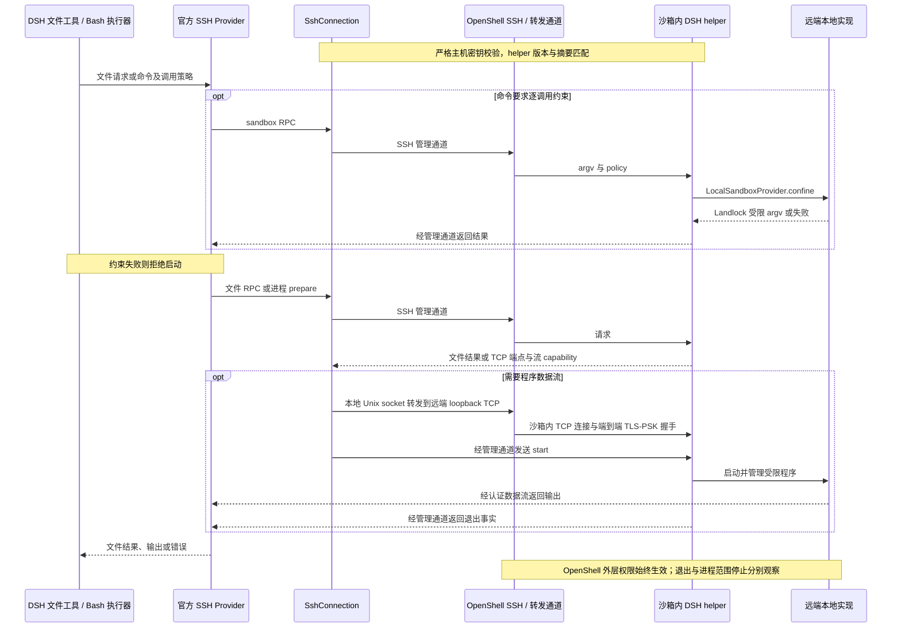

# DSH OpenShell 接入设计

状态：待验证。当前只有工程骨架，以下是方案选择与最小验收设计，不是已实现能力。

## 目标与范围

DSH 在沙箱外运行，文件与程序位于同一个 OpenShell 沙箱。优先复用官方 SSH Provider，通过共享传输的小范围扩展接入 OpenShell；SDK 自研 Provider 仅为备选。

首轮验证文件与有限时长非交互命令。PTY、持续 stdin、LSP、PTC 和审批桥接后续单独验收；依赖未经验证能力的消费者不启用。用户鉴权、租户隔离、任务分配、沙箱创建与回收属于调用方，不在本次设计中。

## 执行环境与版本基准

- DSH：`0.2.1-rc.4`，标签 `dsh-v0.2.1-rc.4`，提交 `504a01a9578abc2c6f1fb896b1dc322c9fe24f66`。
- Node.js：宿主 DSH 与镜像中的脚本 helper 使用 `^22.19.0 || >=24.0.0`，原生 runner 匹配沙箱 Linux 架构。
- pnpm：`12.15.0`。
- OpenShell：调研基准 `v0.1.6`，提交 `ac7f615cd12d5cc49cb16eb1f5f10ffeb1e90f47`；验证固定 CLI、Gateway 与沙箱组件的配套版本。

TCP 扩展需要构建匹配的新客户端与 helper，不能将现有 npm rc.4 包描述为已支持。源码与测试内容调查不代表真实运行通过。

## 首选复用的 DSH 服务与 Provider

| 包名                              | 类名                   | 注册服务         | 职责                                                                     |
| --------------------------------- | ---------------------- | ---------------- | ------------------------------------------------------------------------ |
| `@deepseek-ai/dsh-ssh`            | `SshConnection`        | `ctx.ssh`        | OpenSSH 连接、helper RPC、认证数据流、心跳与清理；TCP 扩展的主要改动位置 |
| `@deepseek-ai/dsh-fs-ssh`         | `SshFileSystem`        | `ctx.fs`         | 远端文件访问、版本条件修改与错误映射                                     |
| `@deepseek-ai/dsh-subprocess-ssh` | `SshSubprocessRuntime` | `ctx.subprocess` | 远端程序与终端句柄、输入输出、取消与退出观察                             |
| `@deepseek-ai/dsh-sandbox-ssh`    | `SshSandboxProvider`   | `ctx.sandbox`    | 请求远端 `LocalSandboxProvider` 生成逐调用受限 argv                      |

沙箱部署 DSH SSH helper，复用其 `SandboxedFileSystem`、`LocalSubprocessRuntime` 与 `LocalSandboxProvider`。`ctx.sandboxPolicy` 和 `ctx.approval` 沿用 DSH 服务。不额外实现 Shell、LLM 或文件工具。

## TCP 端点兼容扩展

当前 DSH 程序流要求 SSH Unix socket 转发，OpenShell v0.1.6 的 SSH handler 没有实现该请求，但已支持到沙箱 loopback 的 `direct-tcpip`。首选扩展 DSH：本地仍使用 Unix socket，远端可选择 loopback TCP；不增加 OpenShell 内部转发协议。

| DSH 修改位置                     | 计划改动                                                              |
| -------------------------------- | --------------------------------------------------------------------- |
| `ssh/src/schemas.ts`             | `SshStreamEndpoint` 扩展为带类型区分的 Unix/TCP 端点，保留 capability |
| `ssh/src/helper-processes.ts`    | 增加 `127.0.0.1` 随机端口监听，保留 TLS-PSK、连接数与握手限制         |
| `ssh/src/index.ts`               | `establishStream()` 按端点类型生成 `ssh -L`，校验 loopback 地址及端口 |
| `ssh/src/protocol.ts` 与配套测试 | 明确协议版本兼容，更新端点消费者、构建摘要与失败清理测试              |

新增传输选择须显式配置并由协议协商或版本检查确认；旧 Unix 模式继续保留。具体配置字段在 DSH 实现时确定。优先向上游提交通用扩展，不在本项目复制 Provider 或私自修改已发布包。

客户端和 helper 必须一致，不用解析 stdout 或拼接模型可控 shell 绕过协议。TCP 模式保留每流随机 TLS-PSK，拒绝错误密钥；绑定仅限沙箱 loopback。TCP 不具备 Unix socket 的路径权限，需验证同沙箱其他进程的未授权连接、资源占用及监听清理，不能仅凭 PSK 声称全部风险等价。

OpenShell 生成的默认 SSH 配置关闭主机密钥校验，不能原样满足 DSH 的严格校验。验证配置需通过可信渠道取得并固定沙箱主机密钥，提供实际 known_hosts，保持 `StrictHostKeyChecking=yes`；密钥变化必须拒绝。

## 数据流

## 权限与执行环境

各 Provider 共用同一 `SshConnection`，连接指向明确配置的 OpenShell 沙箱。默认工作目录不等于授权边界；远端 file URI 不代表本机文件或下载链接。

OpenShell 强制执行外层文件、进程、网络与服务凭据授权。DSH 的逐调用 `read-only`、`workspace-write` 在其内部进一步收紧，不能扩大外层权限。`danger-full-access` 只跳过 DSH 的额外限制。

OpenShell 禁止 bwrap 所需的 mount、namespace 等系统调用。预期复用 `LocalSandboxProvider` 的默认探测：bwrap 不可用后尝试 Landlock。必须在沙箱内探测，不使用宿主结果，也不通过 runnerCommand 跳过验证。DSH runner 以 ABI 5 为完整覆盖基准，`partial` 不得标为 `full`；实际 syscall、规则叠加与部署内核兼容性待验证。

Landlock 的 `read-only` 保留 `/dev/null` 写入，`workspace-write` 额外允许工作区及 `/tmp`，最终权限仍取决于 OpenShell 外层。helper 保持原有外层权限，为每条命令启动新的受限进程，避免只读规则污染下一次调用。文件修改继续由远端 fs-sandbox 落实策略。检查继承可写 fd 与服务调用副作用，不能把文件权限模式描述为禁止所有外部状态变化。

OpenShell Provider 凭据授权只作用于沙箱内请求，不自动覆盖沙箱外 DSH 的模型与网络调用。动态权限审批桥接不在最小验证范围内。

## 失败与生命周期

保留 DSH SSH 的 prepare/start、输出边界、取消、退出观察和 helper 租约逻辑，但必须验证这些机制在 OpenShell 限制下仍可运行。退出结果、数据流关闭和进程范围停止是不同事实。

断线时结果可能未知，不自动重放命令或文件修改，不报告默认成功，不回退本地。无法确认进程清理时明确失败；不能将关闭 SSH 作为远端已停止的证明。TCP listener、未认证连接、转发和取消请求均需由现有生命周期所有者清理。插件释放不删除沙箱。

## 最小验证步骤

按顺序执行，前一步不通过时先定位原因；以下均尚未完成。

| 步骤             | 操作                                                                                    | 通过条件                                                                                                                    |
| ---------------- | --------------------------------------------------------------------------------------- | --------------------------------------------------------------------------------------------------------------------------- |
| 1. 连接与 helper | 固定版本，在镜像安装匹配 helper、Node 与 runner；配置 ProxyCommand 和可信 known_hosts   | 非交互握手、协议与摘要匹配；错误主机密钥和 helper 摘要均拒绝                                                                |
| 2. TCP 数据流    | 构建 TCP 扩展的客户端与 helper，经 OpenShell 转发交换双向字节                           | TLS-PSK 正常；错误密钥拒绝；stdout 暂停不阻塞管理 RPC；失败及关闭后端口、连接和转发释放                                     |
| 3. 工具闭环      | 隔离 Profile 装载官方 SSH Provider；文件工具写入，Bash 读取；测试输出上限与过期版本写入 | 文件与命令同一环境；截断和 spill 可读；版本冲突保留原文件；不访问本地同名路径                                               |
| 4. 逐调用权限    | 在外层允许工作区写入的沙箱中探测 Landlock，顺序执行只读与工作区可写命令                 | 只读写入拒绝；后续工作区写入成功；其他目录、symlink 绕过及子进程写入按策略拒绝；记录 full/partial；外层文件和网络拒绝仍有效 |
| 5. 终态与清理    | 取消带子进程命令、切断连接、让 helper 租约过期，并卸载 Provider                         | 受管理进程和 TCP 资源按约定释放；无法确认时返回失败或未知；无自动重放、虚报成功或本地回退                                   |

完成后记录构建版本、配置、操作结果和远端进程观察证据。首轮通过后再验证 PTY、持续 stdin、LSP 和 PTC 的 fd 7；已有测试不能替代真实 OpenShell 验收。

## 备选方案与项目去留

仅当验证确认 SSH 扩展存在无法合理解决的缺口时，才评估以下 SDK 实现；这些类和子路径均未实现、未承诺发布：

| 计划导出                          | 计划类                       | DSH 基类                                             |
| --------------------------------- | ---------------------------- | ---------------------------------------------------- |
| `dsh-plugin-openshell/fs`         | `OpenShellFileSystem`        | `@deepseek-ai/dsh-fs` 的 `FileSystem`                |
| `dsh-plugin-openshell/subprocess` | `OpenShellSubprocessRuntime` | `@deepseek-ai/dsh-subprocess` 的 `SubprocessRuntime` |
| `dsh-plugin-openshell/sandbox`    | `OpenShellSandboxProvider`   | `@deepseek-ai/dsh-sandbox` 的 `SandboxProvider`      |
| `dsh-plugin-openshell/runtime`    | `OpenShellRuntime`           | 新增 SDK 支撑服务                                    |

备选必须重新验证 SDK 流、文件原子修改、输出与进程清理语义；不能因 SDK 有 exec 就认定满足 DSH 接口。计划文件职责统一见 [README](../README.md#计划目录与文件)。

若首选方案通过且扩展进入 DSH 上游，本项目仅保留确有需要的镜像、配置与组合示例。若这些也可由上游承载，则不再保留独立运行插件。若需长期维护独立传输分支，先评估维护成本再决定，不以保留项目为目标。

## 资料

- [DSH 固定版本 SSH 源码](https://github.com/deepseek-ai/deepseek-harness/tree/504a01a9578abc2c6f1fb896b1dc322c9fe24f66/packages/ssh)
- [OpenShell v0.1.6 SSH handler](https://github.com/NVIDIA/OpenShell/blob/v0.1.6/crates/openshell-supervisor-process/src/ssh.rs)
- [OpenShell v0.1.6 沙箱连接器](https://github.com/NVIDIA/OpenShell/blob/v0.1.6/crates/openshell-sandbox-backend/src/runtime.rs)
- [OpenShell v0.1.6 SSH 配置生成](https://github.com/NVIDIA/OpenShell/blob/v0.1.6/crates/openshell-cli/src/ssh.rs)
- [Linux Landlock 叠加规则](https://docs.kernel.org/userspace-api/landlock.html)
